# Actua

**A native Android client for [Actual Budget](https://actualbudget.org/), built with Kotlin and Jetpack Compose.**

  <picture>
    <source media="(prefers-color-scheme: dark)" srcset="artwork/actua-hero-dark.png">
    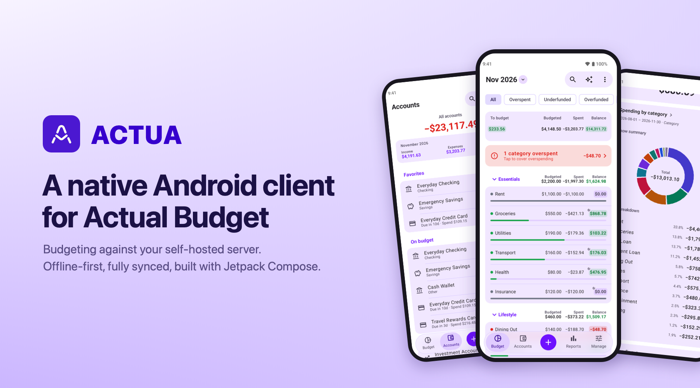
  </picture>

  

  
  
  
  

  
  
  
  

## About

Actua brings Actual Budget to Android with a native Material You interface.

It connects directly to your self-hosted Actual Budget server, keeps a local copy of your budget for offline use, and synchronizes changes with Actual. You can also use Actua completely offline with standalone on-device budgets—no server required.

Actua is an independent community project and is not affiliated with or endorsed by Actual Budget.

## Features

- Native Material You interface in English, Brazilian Portuguese and Spanish
- Connect to your Actual server (password or OpenID) with offline budgets and encrypted sync, or use standalone on-device budgets with no server
- Envelope and tracking budgets with targets, `#template` automations, one-tap cover for overspent categories and Actual's budget actions
- Transactions with splits, transfers, merging and reconciliation, plus rules and automatic categorization as in Actual
- Receipt scanning on your phone with Google ML Kit, in every build
- Bank sync through your Actual server, and imports from CSV, OFX, QFX, QIF, CAMT.053, XLSX, PDF, SMS and notifications, including a Tasker plugin
- Scheduled transactions, a Bills calendar with reminders, credit cards, and loans with a payoff planner
- Dashboards and custom reports with a report builder and tap-through charts
- A customizable Home, tab bar and favorites, with home-screen widgets, launcher shortcuts and a Quick Settings tile
- App lock, hiding Actua from recents, and encrypted backups to your device, Google Drive or WebDAV
- Optional cosmetic Supporter extras (app icons, accent colors, Catppuccin themes, widget styles); budgeting always stays free
- A built-in demo budget and a privacy-safe Diagnostics report

See the [full feature list](docs/FEATURES.md), and [BACKEND_PARITY.md](BACKEND_PARITY.md) for detailed compatibility and implementation status. Actua is reviewed against Actual Budget 26.11, as of 2.4.0 ([details](docs/ACTUAL_26_11_COMPATIBILITY.md)).

## Watch Actua

  <a href="artwork/actua-promo.mp4">
    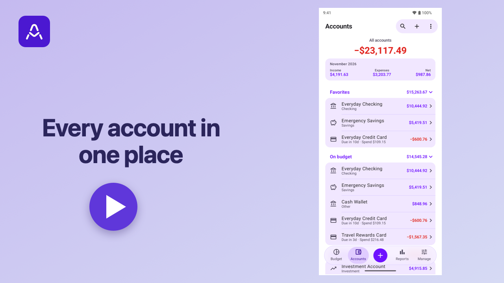
  </a>

A 30-second tour of the budget, accounts and loans, credit cards, reports and widgets, on a demo budget. Select the picture to play it.

## Screenshots

<table>
  <tr>
    <td align="center" width="25%">
      <a href="artwork/screenshots/light/budget.png">
        <picture>
          <source media="(prefers-color-scheme: dark)" srcset="artwork/screenshots/dark/budget.png">
          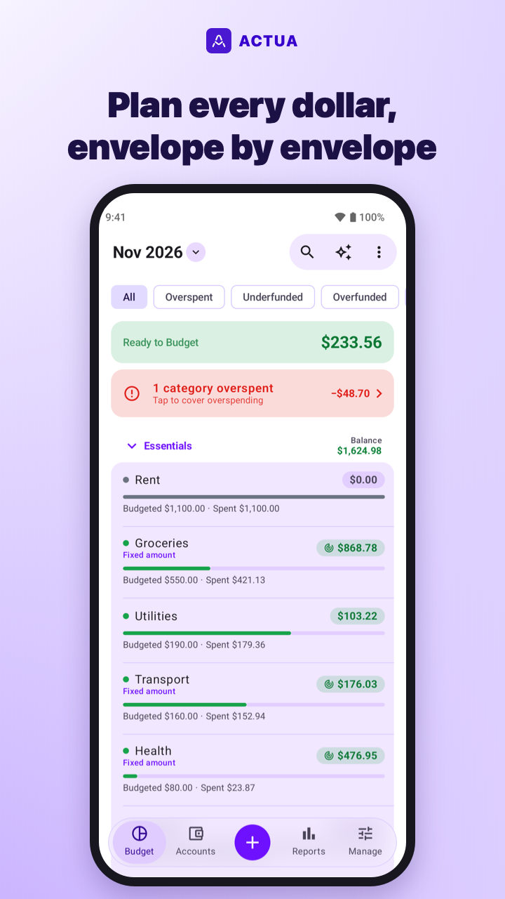
        </picture>
      </a>
    </td>
    <td align="center" width="25%">
      <a href="artwork/screenshots/light/budget-table.png">
        <picture>
          <source media="(prefers-color-scheme: dark)" srcset="artwork/screenshots/dark/budget-table.png">
          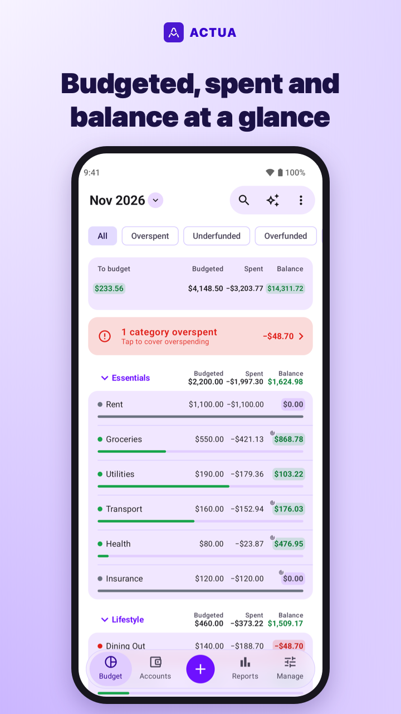
        </picture>
      </a>
    </td>
    <td align="center" width="25%">
      <a href="artwork/screenshots/light/home.png">
        <picture>
          <source media="(prefers-color-scheme: dark)" srcset="artwork/screenshots/dark/home.png">
          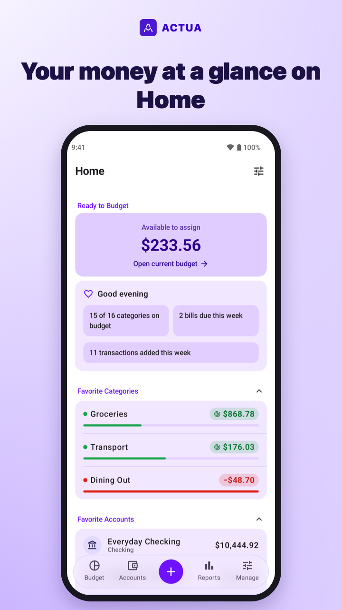
        </picture>
      </a>
    </td>
    <td align="center" width="25%">
      <a href="artwork/screenshots/light/accounts.png">
        <picture>
          <source media="(prefers-color-scheme: dark)" srcset="artwork/screenshots/dark/accounts.png">
          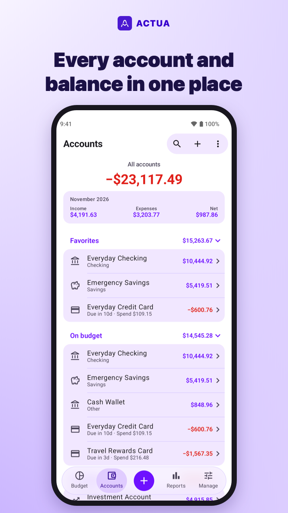
        </picture>
      </a>
    </td>
  </tr>
  <tr>
    <td align="center" width="25%">
      <a href="artwork/screenshots/light/transactions.png">
        <picture>
          <source media="(prefers-color-scheme: dark)" srcset="artwork/screenshots/dark/transactions.png">
          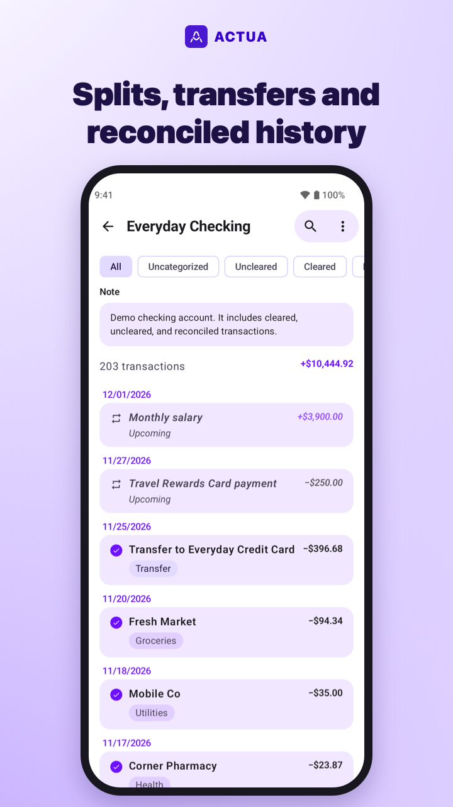
        </picture>
      </a>
    </td>
    <td align="center" width="25%">
      <a href="artwork/screenshots/light/add-transaction.png">
        <picture>
          <source media="(prefers-color-scheme: dark)" srcset="artwork/screenshots/dark/add-transaction.png">
          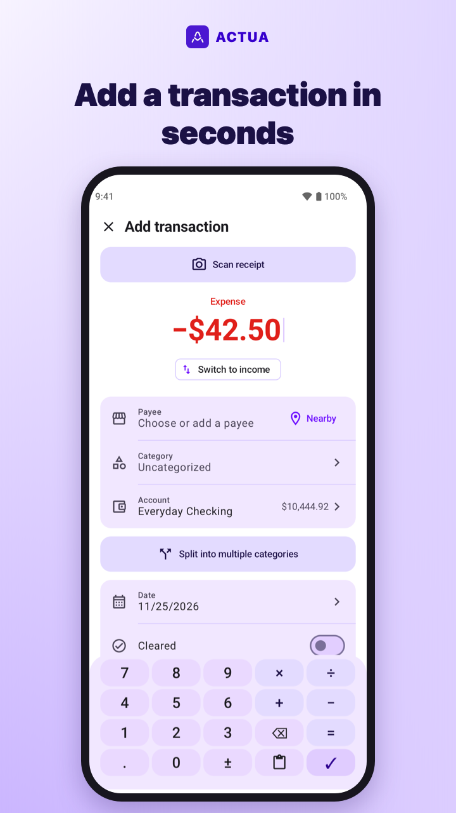
        </picture>
      </a>
    </td>
    <td align="center" width="25%">
      <a href="artwork/screenshots/light/reports.png">
        <picture>
          <source media="(prefers-color-scheme: dark)" srcset="artwork/screenshots/dark/reports.png">
          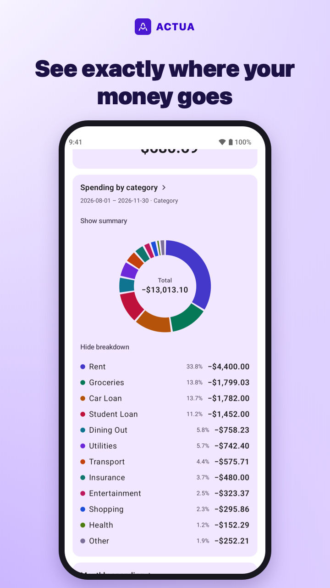
        </picture>
      </a>
    </td>
    <td align="center" width="25%">
      <a href="artwork/screenshots/light/net-worth.png">
        <picture>
          <source media="(prefers-color-scheme: dark)" srcset="artwork/screenshots/dark/net-worth.png">
          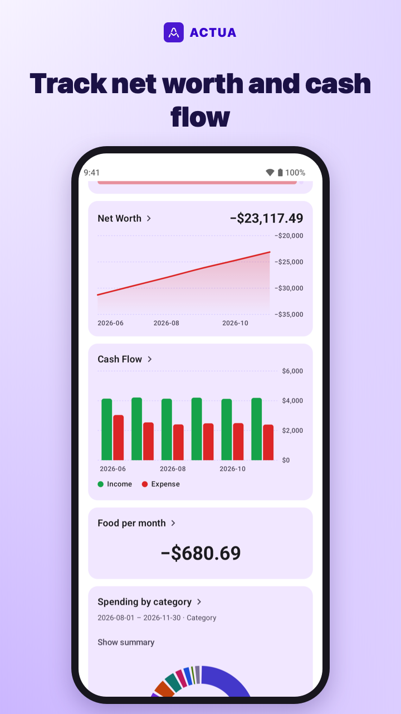
        </picture>
      </a>
    </td>
  </tr>
  <tr>
    <td align="center" width="25%">
      <a href="artwork/screenshots/light/credit-card.png">
        <picture>
          <source media="(prefers-color-scheme: dark)" srcset="artwork/screenshots/dark/credit-card.png">
          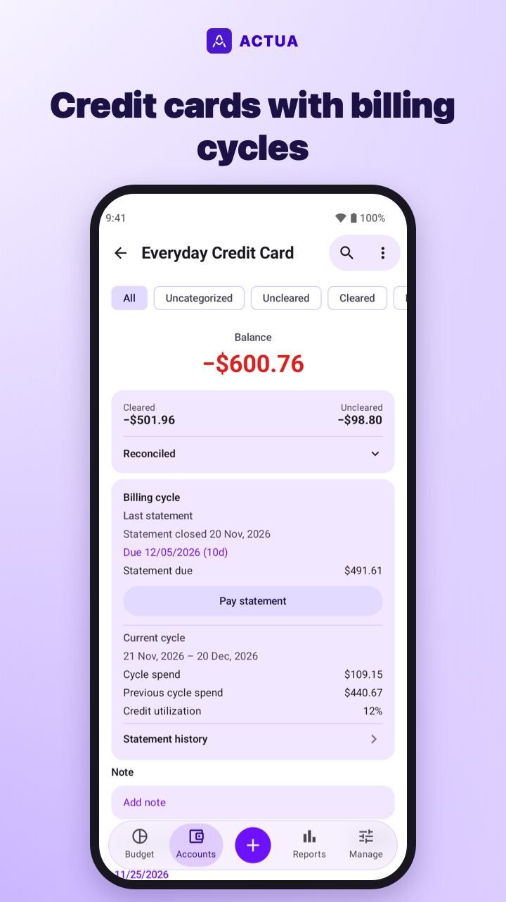
        </picture>
      </a>
    </td>
    <td align="center" width="25%">
      <a href="artwork/screenshots/light/bills-calendar.png">
        <picture>
          <source media="(prefers-color-scheme: dark)" srcset="artwork/screenshots/dark/bills-calendar.png">
          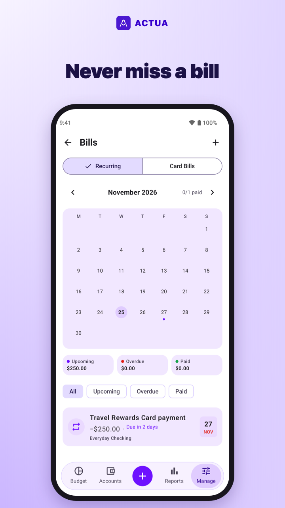
        </picture>
      </a>
    </td>
    <td align="center" width="25%">
      <a href="artwork/screenshots/light/rules.png">
        <picture>
          <source media="(prefers-color-scheme: dark)" srcset="artwork/screenshots/dark/rules.png">
          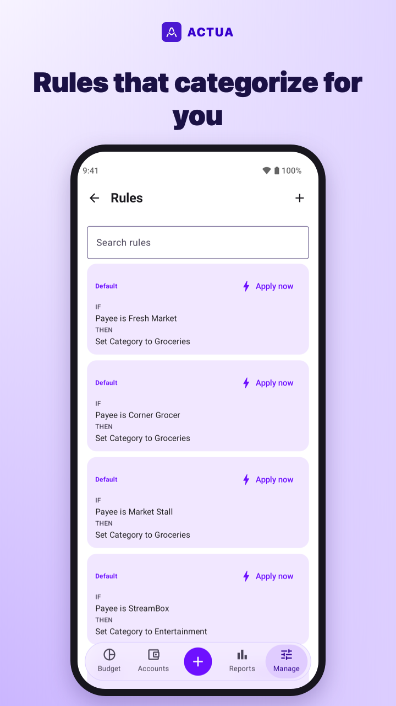
        </picture>
      </a>
    </td>
    <td align="center" width="25%">
      <a href="artwork/screenshots/light/widgets.png">
        <picture>
          <source media="(prefers-color-scheme: dark)" srcset="artwork/screenshots/dark/widgets.png">
          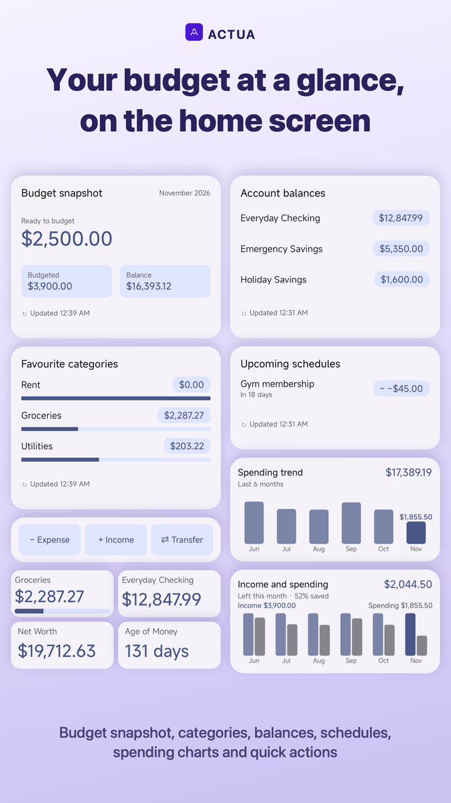
        </picture>
      </a>
    </td>
  </tr>
</table>

Screenshots use a demo budget and follow your GitHub light or dark theme.

### Supporter extras

Optional and cosmetic, unlockable in the Google Play version for now (the GitHub APKs show them locked until website purchases open). Under Settings → Supporter extras, everyone can preview every app icon, accent color, Catppuccin theme and widget style, with the locked ones marked "Supporter". Budgeting always stays free, and Violet and Material You accents are free for everyone.

<table>
  <tr>
    <td align="center" width="25%">
      <a href="artwork/screenshots/light/accent-colors.png">
        <picture>
          <source media="(prefers-color-scheme: dark)" srcset="artwork/screenshots/dark/accent-colors.png">
          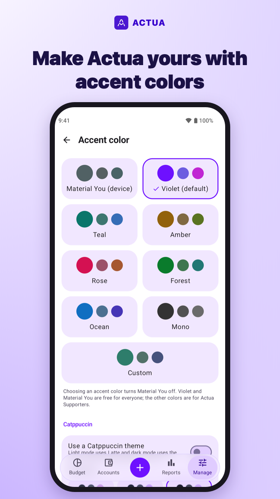
        </picture>
      </a>
    </td>
    <td align="center" width="25%">
      <a href="artwork/screenshots/light/catppuccin.png">
        <picture>
          <source media="(prefers-color-scheme: dark)" srcset="artwork/screenshots/dark/catppuccin.png">
          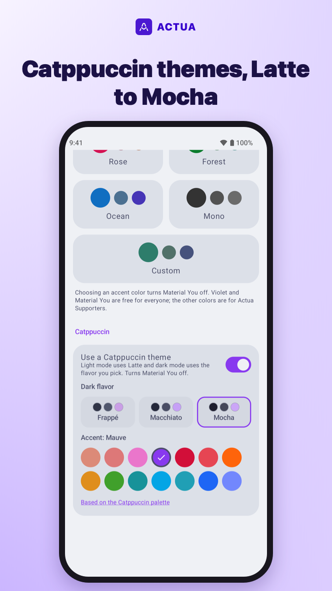
        </picture>
      </a>
    </td>
    <td align="center" width="25%">
      <a href="artwork/screenshots/light/app-icon.png">
        <picture>
          <source media="(prefers-color-scheme: dark)" srcset="artwork/screenshots/dark/app-icon.png">
          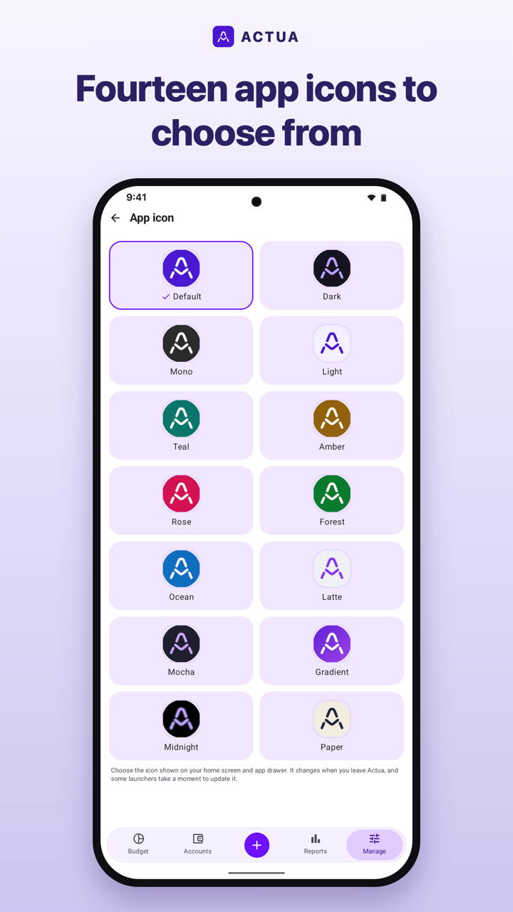
        </picture>
      </a>
    </td>
    <td align="center" width="25%">
      <a href="artwork/screenshots/light/widget-styles.png">
        <picture>
          <source media="(prefers-color-scheme: dark)" srcset="artwork/screenshots/dark/widget-styles.png">
          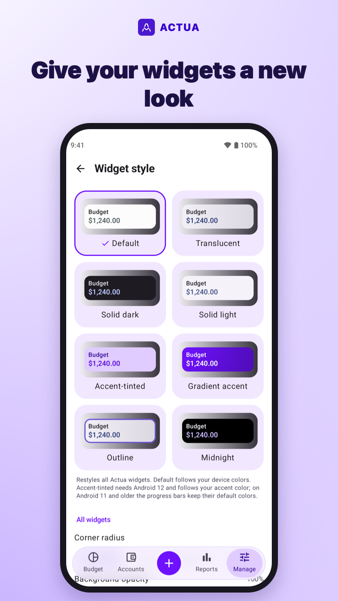
        </picture>
      </a>
    </td>
  </tr>
</table>

## Try Actua

Actua requires **Android 9 or newer**.

**Recommended: [Get Actua on Google Play](https://play.google.com/store/apps/details?id=com.azimulkabir.actua).** You get automatic updates, receipt scanning and optional Support Actua purchases, which unlock cosmetic Supporter extras (budgeting always stays free).

Or install from [GitHub Releases](https://github.com/azimul-kabir/actua/releases):

- `Actua-v<version>.apk`: the Direct Full build, with receipt scanning. Website purchases are not open yet.
- `Actua-v<version>-full.apk`: the Google Play build, for devices without the Play Store.
- [Obtainium](https://apps.obtainium.imranr.dev/redirect?r=obtainium://add/https://github.com/azimul-kabir/actua): update notifications and in-place upgrades. Use its APK filter (for example `-full`) to pick one APK.

The two GitHub APKs update each other. The Google Play version is signed with a different key, so neither can be installed over the other. To switch between Play and GitHub, back up your budget (an archive, WebDAV or Google Drive), uninstall, install the other build and restore; supporter status bought on Google Play stays with the Play version. See [docs/DIRECT_FULL.md](docs/DIRECT_FULL.md).

Don't have an Actual server handy? Open **Manage → Connection & Data → Try demo budget** to explore Actua using a completely local sample budget.

> [!CAUTION]
> Actua can write changes to your synchronized Actual budget. Back up important budgets before connecting a new client.

## Credits

Actua was originally based on and informed by [Actuali](https://github.com/MattFaz/actuali), the open-source iOS client by Matt Farrell.

The project aims for compatibility with [Actual Budget](https://actualbudget.org/) while providing an independently implemented native Android experience.

## Community

Found a bug or have an idea? [Open an issue](https://github.com/azimul-kabir/actua/issues).

Want to discuss Actua, test beta builds, or help with development? [Join the Discord server](https://discord.gg/FhedEyP97f).

## Privacy and terms

See the [Privacy Policy](PRIVACY.md) and the [Terms of Service](TERMS.md), which also cover the optional Support Actua purchases in the Google Play version. Both are published on the [website](https://actua.azimulkabir.com/).

## License

Actua is free software licensed under the [GNU General Public License v3.0](LICENSE).
