# Actua

**A native Android client for [Actual Budget](https://actualbudget.org/), built with Kotlin and Jetpack Compose.**

  <picture>
    <source media="(prefers-color-scheme: dark)" srcset="artwork/actua-hero-dark.png">
    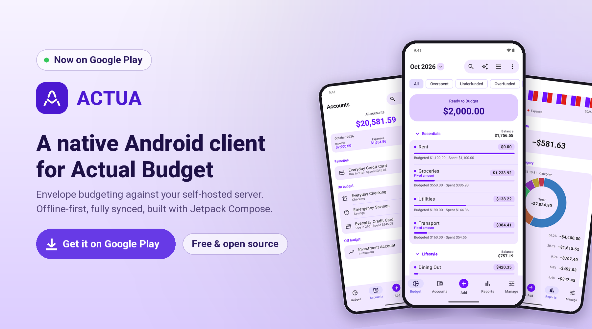
  </picture>

  

  
  
  
  

  
  
  
  

## About

Actua brings Actual Budget to Android with a native Material You interface.

It connects directly to your self-hosted Actual Budget server, keeps a local copy of your budget for offline use, and synchronizes changes with Actual. You can also use Actua completely offline with standalone on-device budgets—no server required.

Actua is an independent community project and is not affiliated with or endorsed by Actual Budget.

## Features

- Native Material You Android interface
- English and Brazilian Portuguese (pt-BR) with in-app language selection
- Home dashboard with an at-a-glance financial overview (ready to budget, favorite categories/accounts, upcoming bills, this month, reports and recent activity), customizable via show/hide and drag-to-reorder, with an optional start day for the This Month summary to match mid-month pay cycles
- Customizable floating bottom tab bar: show/hide and reorder tabs (Reports can be added as its own tab), plus an optional "Add" quick-add tab, and optional hiding while you scroll
- App-wide favorites for categories, accounts and reports, shared by Home, the Budget favorites filter and the home-screen widget
- Password and OpenID/OIDC login
- Standalone on-device budgets: full envelope budgeting without needing a server, with automated schedule posting, local backups, and export/import compatibility with Actual Budget archives (see [docs/STANDALONE_BUDGETS.md](docs/STANDALONE_BUDGETS.md))
- Offline budgets with encrypted Actual sync
- Budgeting, categories and money movement, including one-tap cover for overspent categories, switching budget type between Envelope and Tracking, category group deletion with target reassignment, and Actual's budget actions (3/6/12-month averages, copy last month or to year end, hold income)
- Transactions, splits (including transfer lines in split transactions), transfers, Make transfer for two existing transactions, merging duplicates and reconciliation, including "Use last synced total" for bank-synced accounts
- Amount keypad with + − × ÷ arithmetic
- Bank sync through your Actual server (SimpleFIN and GoCardless), plus experimental Enable Banking for European banks; newly synced transactions are marked until you view the account
- Category targets and budget automations, including `#template` notes, checked against Actual's own template engine
- Scheduled transactions and Bills calendar, with optional reminders before they are due
- Accounts with collapsible groups, custom group creation/management, in-place reordering, group totals, flat favorites, credit cards, payment reminders, loan accounts with a payoff planner, and a device-local month start day for monthly summaries, report presets and report cards
- Actual dashboard and custom reports with a report builder, authoring and card/page management, with smooth line, bar, donut, Sankey, calendar, Budget Analysis and Monte Carlo charts, tap-to-open transactions with search and sorting, a full-screen view with a view-only time range and a data table, optional total and average per period, and date/account filtering
- Rules and automatic categorization, run on manual entry, transfers, imports and bank sync as in Actual, including template, formula and split actions, split rule authoring, live matching preview, and 'Apply rule now' bulk execution
- CSV, OFX, QFX, QIF, CAMT.053, XLSX, PDF, SMS and notification imports, plus a [Tasker plugin and intents](docs/TRANSACTION_IMPORTS.md#tasker-and-other-automation-apps); captured transactions wait in a review queue with per-row, remembered and default accounts, optional review notifications, a launcher shortcut and an Accounts tab badge
- Payee management (rename, merge, delete, favorite, category learning), with suggested and location-aware payees
- Global search, and transaction search that also matches amounts and dates
- Automatic local backups and restore, plus optional Google Drive backup and restore with client-side authenticated AES-256-GCM encryption
- Home-screen widgets and launcher shortcuts
- Currency (including the symbol before or after the amount), date and number formats that follow your budget's Actual settings or a device override, plus appearance options with an optional Material You dynamic-color mode (Android 12+)
- Actual tag management, with colored `#tag` rendering, notes autocomplete, a Manage Tags screen, and tap-a-tag transaction filtering
- Multiple downloaded budgets with a quick switcher in Manage
- Built-in local demo budget
- Privacy-safe Diagnostics report you can copy, save or email when reporting a problem

See [BACKEND_PARITY.md](BACKEND_PARITY.md) for detailed compatibility and implementation status.

## Screenshots

<table>
  <tr>
    <td align="center" width="25%">
      <a href="artwork/screenshots/light/budget.png">
        <picture>
          <source media="(prefers-color-scheme: dark)" srcset="artwork/screenshots/dark/budget.png">
          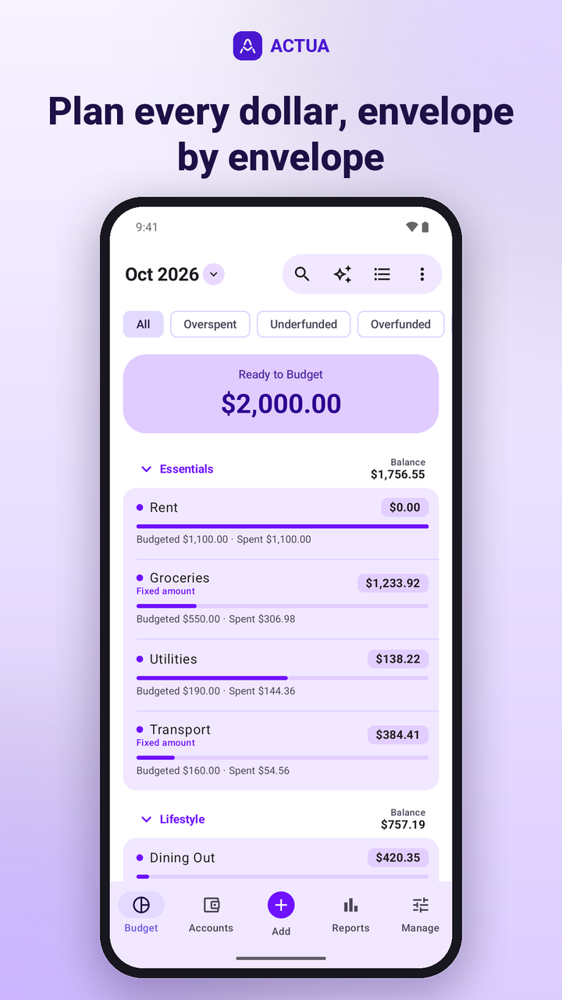
        </picture>
      </a>
    </td>
    <td align="center" width="25%">
      <a href="artwork/screenshots/light/budget-table.png">
        <picture>
          <source media="(prefers-color-scheme: dark)" srcset="artwork/screenshots/dark/budget-table.png">
          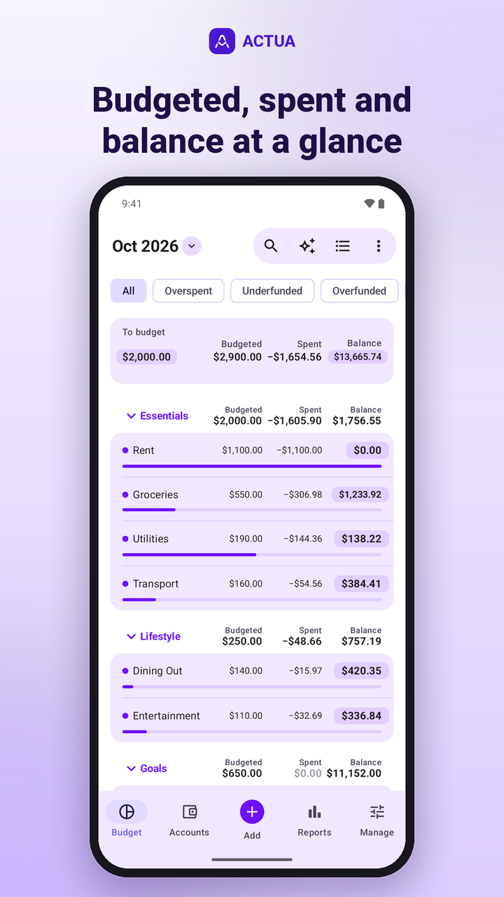
        </picture>
      </a>
    </td>
    <td align="center" width="25%">
      <a href="artwork/screenshots/light/home.png">
        <picture>
          <source media="(prefers-color-scheme: dark)" srcset="artwork/screenshots/dark/home.png">
          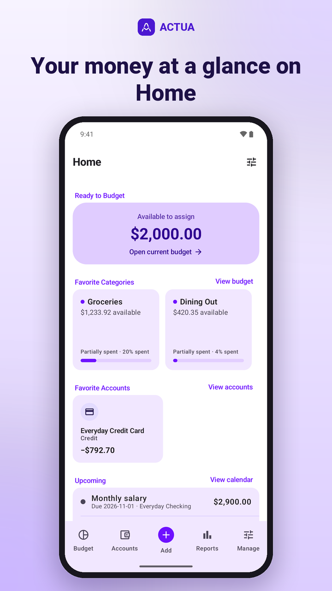
        </picture>
      </a>
    </td>
    <td align="center" width="25%">
      <a href="artwork/screenshots/light/accounts.png">
        <picture>
          <source media="(prefers-color-scheme: dark)" srcset="artwork/screenshots/dark/accounts.png">
          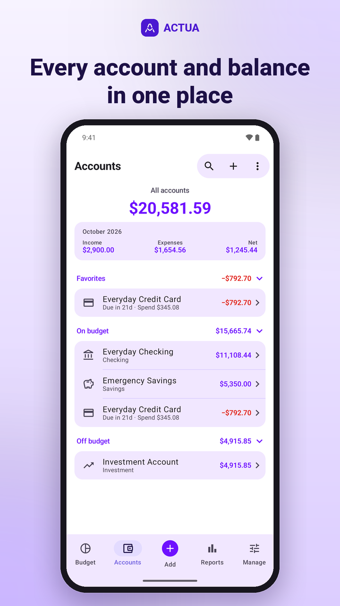
        </picture>
      </a>
    </td>
  </tr>
  <tr>
    <td align="center" width="25%">
      <a href="artwork/screenshots/light/transactions.png">
        <picture>
          <source media="(prefers-color-scheme: dark)" srcset="artwork/screenshots/dark/transactions.png">
          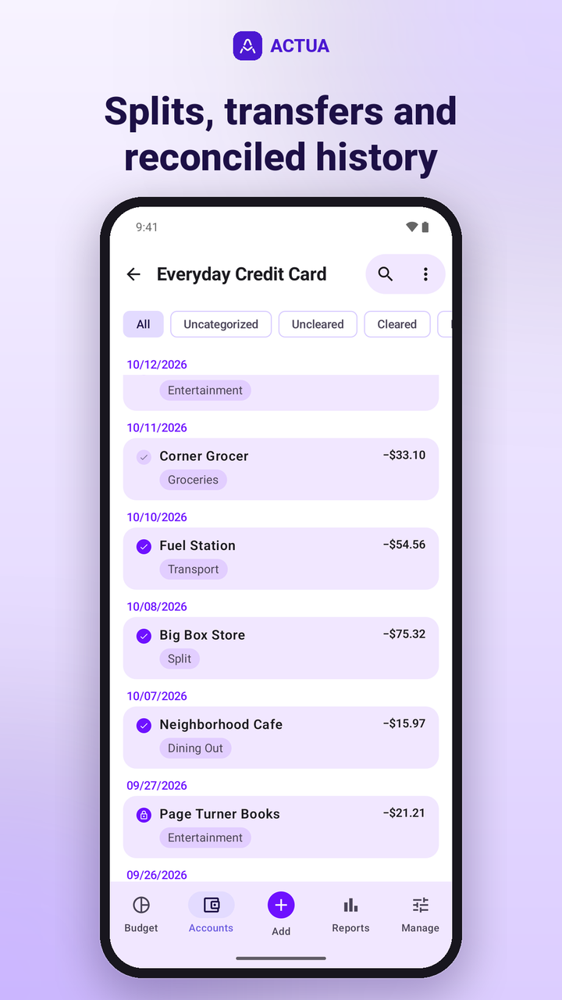
        </picture>
      </a>
    </td>
    <td align="center" width="25%">
      <a href="artwork/screenshots/light/add-transaction.png">
        <picture>
          <source media="(prefers-color-scheme: dark)" srcset="artwork/screenshots/dark/add-transaction.png">
          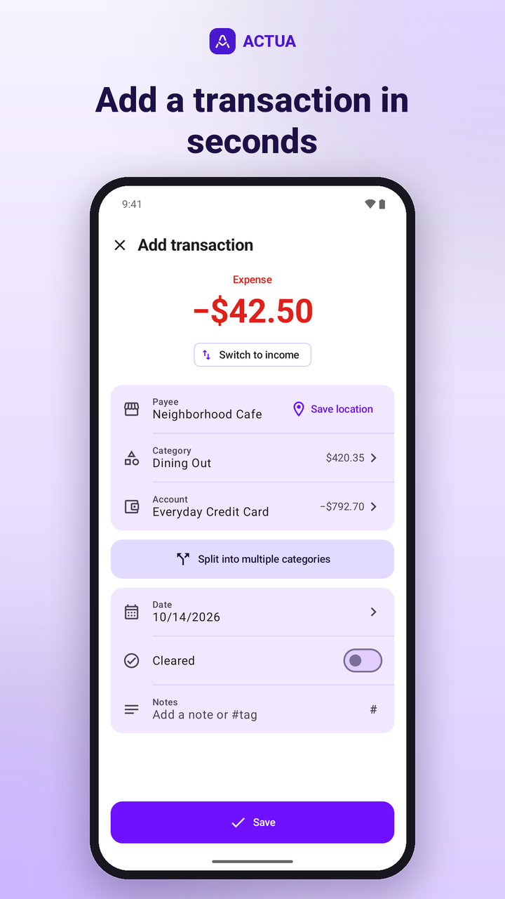
        </picture>
      </a>
    </td>
    <td align="center" width="25%">
      <a href="artwork/screenshots/light/reports.png">
        <picture>
          <source media="(prefers-color-scheme: dark)" srcset="artwork/screenshots/dark/reports.png">
          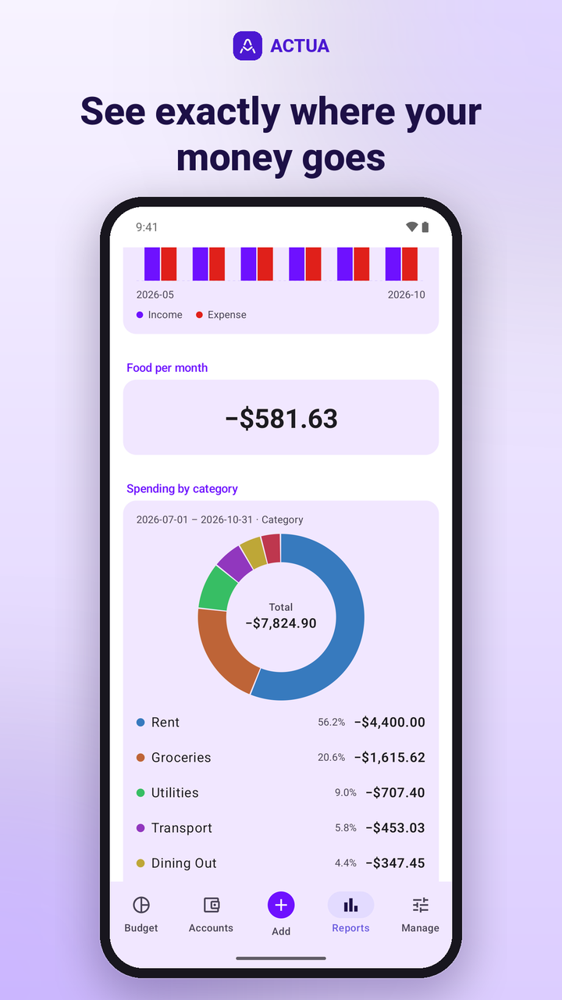
        </picture>
      </a>
    </td>
    <td align="center" width="25%">
      <a href="artwork/screenshots/light/net-worth.png">
        <picture>
          <source media="(prefers-color-scheme: dark)" srcset="artwork/screenshots/dark/net-worth.png">
          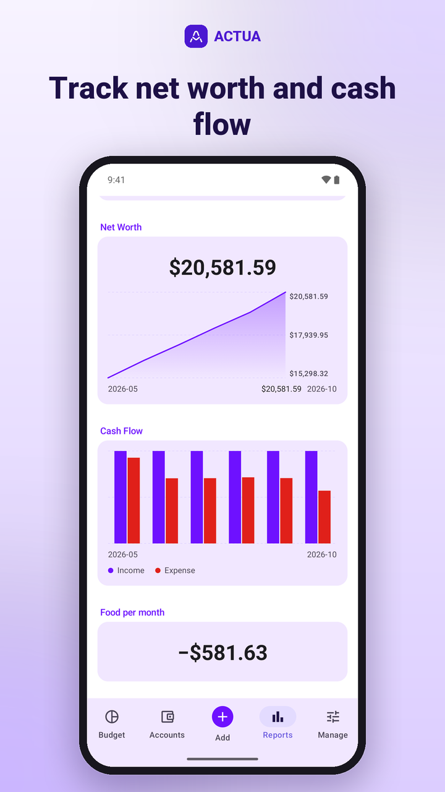
        </picture>
      </a>
    </td>
  </tr>
  <tr>
    <td align="center" width="25%">
      <a href="artwork/screenshots/light/credit-card.png">
        <picture>
          <source media="(prefers-color-scheme: dark)" srcset="artwork/screenshots/dark/credit-card.png">
          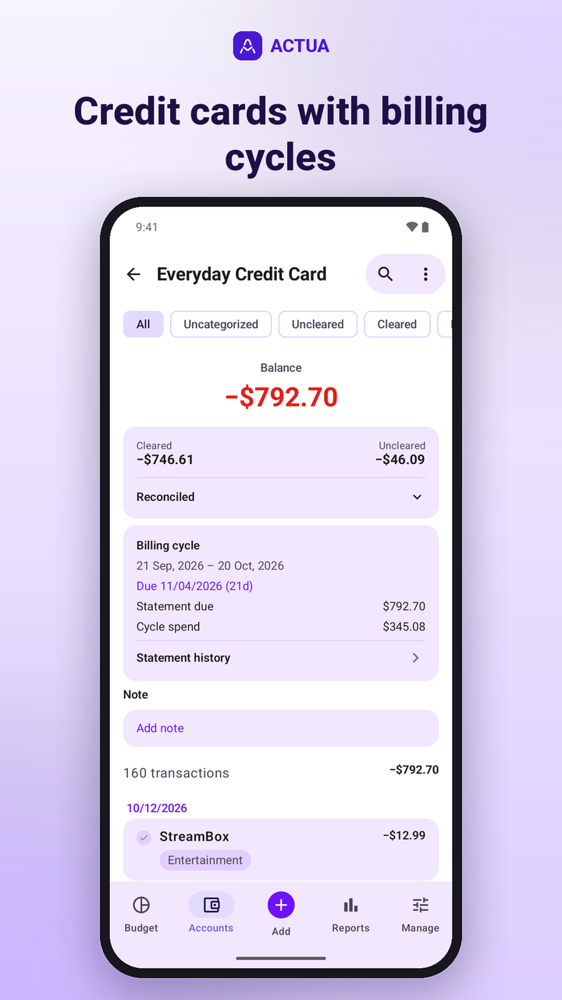
        </picture>
      </a>
    </td>
    <td align="center" width="25%">
      <a href="artwork/screenshots/light/bills-calendar.png">
        <picture>
          <source media="(prefers-color-scheme: dark)" srcset="artwork/screenshots/dark/bills-calendar.png">
          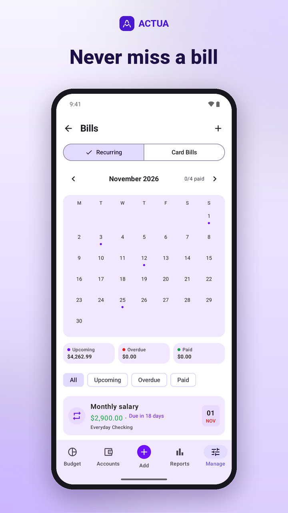
        </picture>
      </a>
    </td>
    <td align="center" width="25%">
      <a href="artwork/screenshots/light/rules.png">
        <picture>
          <source media="(prefers-color-scheme: dark)" srcset="artwork/screenshots/dark/rules.png">
          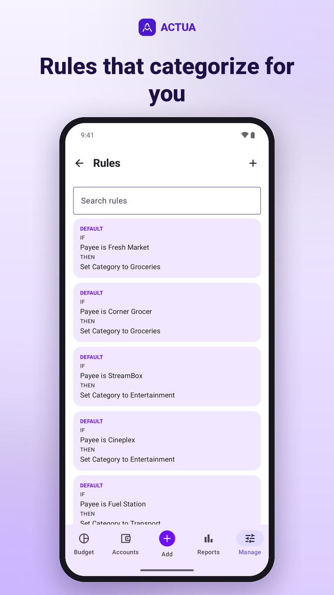
        </picture>
      </a>
    </td>
  </tr>
</table>

Screenshots use the built-in demo budget and follow your GitHub light or dark theme.

## Try Actua

Actua requires **Android 9 or newer**.

Actua is available to everyone on [Google Play](https://play.google.com/store/apps/details?id=com.azimulkabir.actua). You can also download the latest APK from [GitHub Releases](https://github.com/azimul-kabir/actua/releases) or add Actua to Obtainium for update notifications and in-place upgrades.

Don't have an Actual server handy? Open **Manage → Connection & Data → Try demo budget** to explore Actua using a completely local sample budget.

> [!CAUTION]
> Actua can write changes to your synchronized Actual budget. Back up important budgets before connecting a new client.

## Credits

Actua was originally based on and informed by [Actuali](https://github.com/MattFaz/actuali), the open-source iOS client by Matt Farrell.

The project aims for compatibility with [Actual Budget](https://actualbudget.org/) while providing an independently implemented native Android experience.

## Community

Found a bug or have an idea? [Open an issue](https://github.com/azimul-kabir/actua/issues).

Want to discuss Actua, test beta builds, or help with development? [Join the Discord server](https://discord.gg/FhedEyP97f).

## License

Actua is free software licensed under the [GNU General Public License v3.0](LICENSE).
