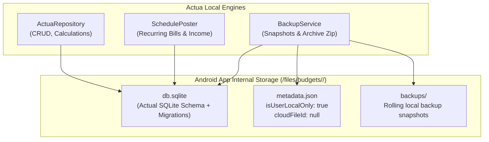
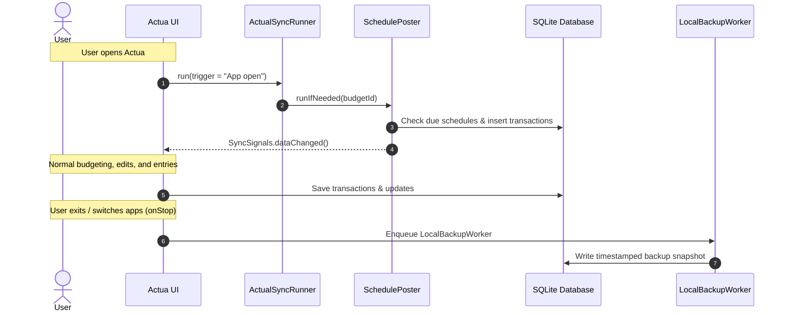

# Standalone (On-Device) Budgets in Actua

Actua supports **standalone, on-device budgets**—allowing you to use the full power of Actual Budget's envelope budgeting, transaction management, reports, rules, and schedules entirely offline on your Android device without hosting an Actual Budget server.

This guide explains how standalone budgets work, how to create, import, and manage them, how automated schedules and backups operate locally, and how you can optionally promote a standalone budget to an Actual server at any time.

---

## 1. Overview

While Actua was designed primarily as a native client for [Actual Budget](https://actualbudget.org/) servers, standalone mode provides a first-class, privacy-first option for users who want:

- **Zero server setup**: No VPS, Docker container, or cloud server required.
- **Complete local privacy**: Financial data stays entirely on your device.
- **Full Actual Budget engine**: Not a stripped-down client—standalone budgets run the exact same SQLite schema, envelope/tracking budget math, rule engine, and schedule automation as server-backed budgets.
- **Interoperability**: Complete export and import compatibility with Actual Budget desktop and web apps via standard `.zip` archives.

### Standalone vs. Demo Budget

Actua also includes a built-in **Demo budget**. However, the Demo budget is intended only for quick evaluation—it resets its data whenever re-launched. In contrast, **standalone budgets are permanent, user-owned budgets** with full local backup retention, custom categories, transaction imports, and data persistence.

---

## 2. Architecture and Storage Model

Every standalone budget in Actua uses the same battle-tested storage layer as server-connected budgets:



### Storage Components

1. **`db.sqlite`**:
   - An SQLite database initialized with all upstream Actual Budget schema migrations (`BlankBudgetFactory.SCHEMA`).
   - Stores transactions, accounts, categories, rules, schedules, notes, and dashboard widget layouts.
   - Every transaction write records local Conflict-free Replicated Data Type (`messages_crdt`) rows with timestamps from Actua's Hybrid Logical Clock (HLC). This ensures that if the budget is later uploaded to a server, all history syncs seamlessly.

2. **`metadata.json`**:
   - Defines the budget's identity and operational mode.
   - For standalone budgets:
     ```json
     {
       "id": "e6745f44-...",
       "budgetName": "My Local Budget",
       "isUserLocalOnly": true,
       "cloudFileId": null,
       "groupId": null,
       "encryptKeyId": null,
       "resetClock": true
     }
     ```
   - Actua's `BudgetMetadata.isUserLocalOnly` property identifies the budget as standalone, routing sync and maintenance operations locally.

---

## 3. Creating and Managing Standalone Budgets

### Onboarding (Fresh Install)

When launching Actua without an active budget:

1. The **No Budget** screen displays two main options:
   - **Connect to Actual**: For users connecting to a self-hosted server.
   - **Use without a server**: Directly creates or imports an on-device budget.
2. Tap **Create local budget**, enter a name (e.g., "Personal Budget"), and Actua provisions a clean budget initialized with standard starter categories (Income, Bills, Food, General) and default dashboard cards.
3. Alternatively, tap **Import backup archive** to select a `.zip` archive exported from Actual Budget or an Actua backup.

### Management in Connection & Data

You can create, switch between, and manage multiple standalone budgets at any time:

1. Navigate to **Manage › Connection & Data**.
2. Scroll to the **On this device** section (available whether or not a server is configured).
3. From here you can:
   - **Create local budget**: Provision a new blank budget.
   - **Import backup archive (.zip)**: Restore or migrate an existing budget.
   - **Switch active budget**: Tap **Open** on any local budget to switch immediately.
   - **Delete local budget**: Tap **Delete** and type the exact budget name to confirm permanent removal.

---

## 4. Archive Import, Export & Compatibility

Actua provides bi-directional archive compatibility with upstream Actual Budget:

### Supported Formats

- **Root-level archive**: A `.zip` file containing `db.sqlite` and `metadata.json` at the root (standard Actua export format).
- **Directory-enclosed archive**: A `.zip` file enclosing `db.sqlite` and `metadata.json` inside a parent folder (standard Actual web/desktop export format).

Both formats are automatically detected, unpacked, and validated by `BudgetFileManager.importLocalBudget`.

### Safety and Normalization on Import

When importing an archive into standalone mode:

- **Archive safety check**: Rejects archives exceeding 500 MB uncompressed or containing malicious path traversal entries (`..`).
- **Database validation**: Confirms the SQLite structure passes `ActualBudgetDatabase.validate()` and `BudgetOpenProbe.validate()`.
- **Identity collision resolution**: If the archive's internal budget ID matches an existing local budget, a fresh unique ID is generated so existing budgets are never overwritten.
- **Server field stripping**: Clears `cloudFileId`, `groupId`, `lastUploaded`, and `encryptKeyId` so the imported budget is safely recognized as local-only.
- **Clock initialization**: Resets the clock (`resetClock: true`) with a fresh unique node ID (`HybridLogicalClock.generateNodeId()`).

### Exporting Your Data

To create a full export of your standalone budget:
- Navigate to **Manage › Connection & Data › Backups**.
- Tap **Export archive** to share or save a standard `.zip` file.
- This `.zip` can be imported into another Actua installation or loaded directly into Actual Budget desktop/web.

---

## 5. Automated Schedules and Local Backups

In a server-connected budget, the Actual server coordinates scheduled transactions and backups during remote sync. For standalone budgets, Actua executes these tasks **completely automatically on-device**:



### 1. Automatic Schedule Auto-Posting (On App Open)
- Recurring bills, subscriptions, paychecks, and transfers configured in **Manage › Schedules** automatically post when their due date arrives.
- Every time you open or return to Actua, `AppNavigation` executes `ActualSyncRunner.run(..., trigger = "App open")`.
- For standalone budgets, `SchedulePoster.runIfNeeded` scans all active schedules, generates real transactions for any due dates, advances the schedule's `next_date`, and signals `SyncSignals.dataChanged()` to refresh on-screen accounts and category balances.

### 2. Automatic Local Backups (On App Exit)
- Whenever you leave Actua or switch to another app (`MainActivity.onStop`), Actua enqueues `LocalBackupWorker` using Android WorkManager.
- This creates a clean snapshot of `db.sqlite` in the budget's internal `backups/` directory.
- Up to 10 rolling snapshots are maintained automatically.

### 3. Periodic Background Maintenance
- Android WorkManager runs a recurring periodic task (`actua-periodic-sync`) every 15 minutes to evaluate schedules, refresh upcoming bill reminder notifications, and update home-screen widgets.

### 4. Manual Trigger ("Process schedules & backup")
- In **Manage › Connection & Data**, the manual sync button automatically adapts for standalone budgets, displaying:
  > **Process schedules & backup**
- Tapping this button immediately processes any due schedules, creates a backup snapshot, and displays an on-screen confirmation (`"Processed schedules and saved local backup."`).

---

## 6. Safety, Isolation, and Error Recovery

Actua includes several architectural safeguards specifically for standalone budgets:

### Disconnect & Reset Protection
In **Connection & Data**, disconnecting from a server or clearing server data removes only downloaded server-backed databases and cached server tokens. **Standalone budgets, their local databases, and their backup snapshots are strictly preserved** (`DisconnectResetManager`).

### Unreadable Budget Quarantine
If a standalone database cannot be opened due to a filesystem glitch or unexpected corruption:
- Actua **never deletes** the database (`ActuaRepository.discardUnreadableBudget`).
- Instead, the unreadable budget is safely quarantined to `.quarantine-<budgetId>-<timestamp>`, and the user is prompted to restore from the latest local backup snapshot.

### Clean UI Messaging
- When using a standalone budget, server-specific warnings (such as the `SessionExpiredBanner`) are suppressed even if expired server tokens exist on the device.
- The Connection & Data status card displays "Local only" indicators rather than server sync metrics.

---

## 7. Promoting a Standalone Budget to an Actual Server

If you start with an on-device budget and later decide to set up an Actual Budget server (or join a family server), you can promote your standalone budget seamlessly without losing any transactions or history:

1. In **Manage › Connection & Data**, sign in to your Actual Budget server with your server URL and password (or OpenID).
2. Under **On this device**, find your standalone budget and tap **Upload to server**.
3. Confirm the upload prompt. Actua will:
   - Validate server connectivity.
   - Upload the local `db.sqlite` and metadata to the server.
   - Receive the official `cloudFileId` and `groupId` from the server.
   - Transition the budget from local-only (`isUserLocalOnly = false`) to server-backed sync.
4. **Safety Guarantee**: If the upload fails due to network dropouts or server authentication errors, the promotion safely aborts and the budget remains fully functional as a local standalone budget.

---

## 8. Feature Parity Matrix

The following table summarizes feature availability between standalone and server-connected modes:

| Feature | Standalone (On-Device) | Server-Backed | Notes |
| :--- | :---: | :---: | :--- |
| **Envelope & Tracking Budgeting** | Yes | Yes | Identical budget calculations, rollover, and targets. |
| **Accounts & Balances** | Yes | Yes | Checking, savings, credit cards, investments, off-budget. |
| **Transactions, Splits & Transfers** | Yes | Yes | Full two-leg transfers, split transactions, and tags. |
| **Reconciliation** | Yes | Yes | Cleared balances, locking, and reconciliation adjustments. |
| **Rules Engine** | Yes | Yes | Automated categorization, field transforms, and split rules. |
| **Scheduled Transactions** | Yes | Yes | Recurring schedules auto-post on app open and in background. |
| **Bills Calendar & Due Reminders** | Yes | Yes | Upcoming bill notifications and payment planning. |
| **Statement File Imports** | Yes | Yes | OFX, QFX, QIF, CAMT.053, and CSV file imports. |
| **SMS & Notification Capture** | Yes | Yes | Automated bank SMS/push transaction capture and review queue. |
| **Tasker Automation & Intents** | Yes | Yes | Tasker plugin and broadcast intents add to active budget. |
| **Reports & Custom Dashboards** | Yes | Yes | Net Worth, Cash Flow, Spending, Sankey, Monte Carlo, etc. |
| **Home-Screen Widgets** | Yes | Yes | Quick-entry, category balances, and dashboard widgets. |
| **Automated Local Backups** | Yes | Yes | Rolling local backup snapshots saved to internal storage. |
| **Archive Export / Import** | Yes | Yes | Standard `.zip` archives compatible with Actual web/desktop. |
| **Google Drive Backup** | Optional | Optional | Off-device cloud backup if configured. |
| **Multi-Device Real-Time Sync** | No | Yes | Requires an Actual Budget server. |
| **Bank Sync (SimpleFIN / GoCardless)** | No | Yes | Bank aggregation tokens and sync run through the server. |
